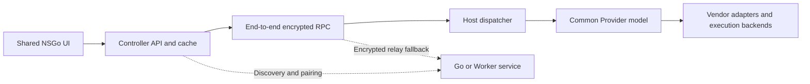

# Architecture standards

## Responsibilities and sources of truth

The controller owns interaction and local cache. The controlled host runs Agent adapters and execution. The device service provides discovery, pairing, signaling and encrypted relay; it does not run Agents or store conversation plaintext.

| Layer                  | Source                                                           | Owns                                                              |
| ---------------------- | ---------------------------------------------------------------- | ----------------------------------------------------------------- |
| Presentation           | `clients/nsgo/hubui`                                             | Layout, interaction, view state, controller-side grouping         |
| Controller application | `internal/clienthub`, `clients/nsgo/webapi`                      | Paired identity, connections, cache and RPC                       |
| Host application       | `internal/host`, `internal/app`                                  | Configuration, authorization, lifecycle, Provider composition     |
| Business model         | `internal/control`, `internal/provider`                          | Dispatch, sessions, messages, approvals, capabilities             |
| Agent adapters         | `internal/codex`, `internal/agents`                              | Vendor protocols, processes, local session access                 |
| Transport              | `internal/remote`, `internal/transport`, `internal/connectivity` | Encryption, active paths, frame scheduling, probes, retry budgets |
| Device service         | `internal/deviceservice`, `packages/worker-core`                 | The common public service contract                                |
| Persistence            | `internal/store` and cache adapters                              | Transactions, permissions, ownership and bounded caches           |

Presentation does not own Agent processes, database connections or vendor schema interpretation. Providers do not import UI or branch on the service runtime. Services route ciphertext without interpreting tool output. Compose dependencies at the application boundary.

## Shared UI and alternative services

Desktop, mobile and browsers share the NSGo controller; native and Web adapters express capability differences without copying pages or state machines. Next.js/Fumadocs serves the separately built official website.

Go uses SQLite, HTTP/WebSocket and optional integrated TCP/UDP probes. Worker uses D1, Durable Objects and platform bindings. Align external behavior, not table layouts or implementation lines; see [service parity](service-parity.md). Both self-hosting options remain complete and account-free. Their packages include the console and service; marketing and docs are published separately.

## Lifecycle and state transitions

Separate page, connection-attempt, established-connection, read-request and Agent-execution lifetimes. A remote timeout or phone disconnect must not implicitly stop a local Agent task. Explicit interruption and shutdown of a ReignHub-owned executor are distinct events.

Bound connection setup and individual requests; established connections and subscriptions need independent cancellation, liveness and cleanup. Bound queues, event logs, reassembly and concurrency. Cancel obsolete reads, and check context, device/session identity and generation before publishing results. UI state belongs to the UI loop; I/O and parsing run outside it.

Initial history, live watch and approvals progress independently. Publish history progressively in order. Persist received content with its applied cursor; a cursor must never acknowledge missing content. Rebuild only the affected baseline after replay-window loss. Isolate session failures with their own backoff.

## Provider boundary and session metadata

Normalize vendor data into `Session`, `Turn`, `Item`, `Approval` and implemented `Capabilities` at the adapter boundary. Do not forward raw notifications, private reasoning or tool output as conversation text.

The host supplies `projectDir` and actual execution directory `cwd`. Controllers group by `projectDir || cwd` within a device, using the same rule across Agents. Names and vendor project IDs are not directory identity. A controller must not inspect its own filesystem to infer a remote project. Explicit project roots and worktree resolution follow the [Provider reference](../platform/agent-providers.md).

Document vendor-specific discovery, ownership transfer, local protocols and backend selection beside the relevant Provider code.

## Authorization and recovery

A host becomes remotely ready only after obtaining a valid service identity and authorization public key. Failed discovery must remain retryable; public-STUN defaults cannot substitute for missing trust configuration. Preserve service identity and signing keys across restarts.

Local pairing permission, signed service leases and optional commercial policy are separate boundaries. Validate authorization on direct and relay paths. Distinguish network failure, expired authorization and unavailable Agent capabilities; account-free deployments must not suggest signing in to fix ordinary network errors.

Record cross-cutting changes in [decisions](decisions.md), including lifecycle, persistence, runtime and verification effects. Internal testing permits direct protocol/cache redesign; identity preservation and failure recovery remain required.
