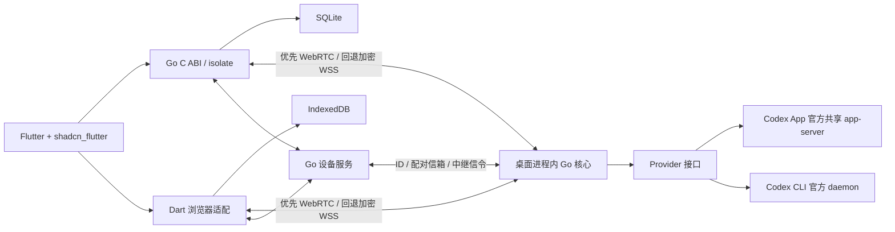

# MVP 实现与协议

本文件描述运行代码；长期产品目标见 product-v2.md。

## 分层

桌面默认展示本机；选设备后切换会话栏 / 对话区。UI 是可替换客户端，主机授权、Provider、网络和目录索引留在 Go。Web 只实现控制端的浏览器适配，不通过浏览器 FFI 执行 Go。Web 页面与 API / relay 由同一个服务提供；新连接和重连均以页面 origin 为服务地址，不读取构建时的服务器地址，也不提供地址输入框。多个连接共享同一套协议和各自持久化缓存。

## 设备服务

`cmd/agenthub-service`：持久设备目录、12 位数字连接 ID、哈希存储的服务 token、两分钟加密配对信箱、host/client 成对授权、中继路由。默认仅本机监听；公网经 TLS 反向代理。限制设备总量、配对数、注册 / 请求速率和每主机并发连接。设备清理、分布式扩展、配额计费、邮件 / OIDC 账号不是本期能力。服务文件丢失需要重新登记；不把连接 ID 当作身份认证。

| POST 路径 | 用途 |
| --- | --- |
| `/v2/register` | 登记公钥与设备类型，返回 ID / token |
| `/v2/presence` | 更新在线时间、名称 |
| `/v2/resolve` | 按数字 ID 找到主机公钥 |
| `/v2/pair/request` | 提交加密授权意图 |
| `/v2/pair/pending` | 主机读取待确认意图 |
| `/v2/pair/result` | 控制端等待结果 |
| `/v2/pair/respond` | 主机确认 / 拒绝，发送加密授权密钥 |
| `/v2/revoke` | 主机撤销某控制设备 |

除 register 外需要注册 token。`/relay` 是 WebSocket：仅允许 host 自己注册 host 路由、已授权 client 进入对应 host；服务器附加真实 client 身份，忽略伪造字段。浏览器经 WebSocket 子协议提交 token，避免 URL 日志泄漏。

配对信封：X25519 + HKDF-SHA256 + AES-256-GCM，上下文绑定 request ID 和方向。密码密文发送到主机，以 bcrypt 哈希验证；服务不处理密码。主机允许后生成随机的每设备授权密钥；每条网络连接再绑定双方随机 challenge。仅 iOS / Android 原生客户端提供相机扫码；桌面和 Web 通过设备 ID 连接，被控桌面可展示二维码供手机扫描。二维码 `agenthub2:` 只带版本、service、connectionId、public。初始纯 ID 发现信任服务的公钥目录；二维码有额外公钥固定。

授权方式为永久记住（可撤销）或临时 8 小时；临时期间可重连。主机撤销会关闭该设备当前 DataChannel 并拒绝后续 RPC，其它客户端继续工作。已有缓存不会从已经授权过的控制端自动抹除；用户可在该控制端删除设备清理缓存。

## 主机 / 客户端接口

桌面进程内 C FFI：`host.bootstrap/info/configure/password/respond/revoke/enable/activate`。Flutter 直接进入 Go Dispatcher，不启动 helper 或本机 HTTP 控制监听。仅本机 UI 可调用；远端路由拒绝这些生命周期接口。macOS 配对待确认时会打开宿主授权窗口；UI 不在时也不会自动允许。

远端：`providers/network/sync/sessions/transcript/models/create/send/steer/interrupt/approvals/decide`。Provider 必须完成真实协议握手，状态为 ready / connected；App 还须匹配 Hub 记录的启动实例（PID / 启动时间 / 路径）及该实例到指定官方 server 的实际连接。仅发现进程、读到历史或启动后端均不能标记为可控。不设置额外的 Agent 远控开关；设备配对授权仍独立校验。检测到已运行的 CLI 官方后台后自动附加，不启动新后台或恢复会话；显式点击「启用」才可启动缺失的后台。App 的「启用」合并后端准备与 App 接入，重启前仍需确认。原始 Codex 线程 ID 保持不变。App 和 CLI 保留各自实际控制路由，界面聚合同一项目的会话；创建来源不代表后端所有权。

原生 bridge：`client.list/connect/disconnect/forget/call/sync`，可同时保持多个主机连接。移动端只开放 client 接口。

## 会话来源与工作目录

读取入口与创建来源独立：`providerId` 保持实际控制路由，`source` 保留 Codex 原始来源 JSON，`originator` 保留记录的创建客户端，`sourceKind` 是用于图标和提示的创建来源分类。CLI 共享后台可以列出本机其它客户端的历史，不能因此把这些会话都标成 CLI。

当前使用 `thread/list` 的 `source` + `originator` 区分 CLI、Codex App、VS Code、Agent Hub、子 Agent、Exec / 自动化、App Server 和其它客户端；App 与 IDE 都可能返回 `source=vscode`。只有已知的 `Codex Desktop` / `codex_desktop` 与 `codex_vscode` 等 originator 才进一步细分；缺失字段的 vscode 旧记录标为「IDE / App（未细分）」。这是创建来源，不证明会话当前由哪个客户端打开或可写。原始元数据保留，未通过目录或当前进程猜测来源。协议来源类型参考 [OpenAI Docs](https://learn.chatgpt.com/docs/app-server)，本机 `originator` 字段经 Codex 0.167.0 生成的实验性 TypeScript schema 与 0.167.1 后台返回值核对。

所有端按远端完整 `cwd` 聚合各 Agent 的会话，来源只通过图标区分，不提供 Agent / 来源筛选。已知的 Codex VS Code Provider 与会话隐藏；来源不明确的旧记录保留。App / CLI 返回的相同 Codex 线程去重并保留现有路由，优先选用与已知创建来源匹配的可用路由；这不证明线程由该运行时持有。不同父目录下同名项目不合并，不按控制端操作系统改写路径。目录按组内最大 `updatedAt` 倒序，组内会话也按 `updatedAt` 倒序，同时间用路径 / 会话键稳定排序。缺失目录归「无工作目录」。项目支持折叠，默认展示最近 5 条并可展开全部；目录菜单提供会话数和完整路径，项目新聊天预填工作目录。来源和目录字段跟随现有全量 / 增量同步缓存。

## 对话展示与模型

保留 shadcn_flutter 外观，使用 `super_sliver_list` 的变高虚拟列表与索引跳转。反向列表初始位于底部，只渲染视口附近消息；追加消息与加载历史保留阅读锚点，位于底部时自动跟随。左侧绘制有上限的导航刻度，悬停预览用户消息，点击定位；离开底部后可回到最新。正文显示用户和助手内容；最新一轮生成时，保留公开的 assistant commentary，与相邻的工具活动组按协议顺序混排。内部 reasoning 和原始工具输出不进入正文。轮次完成后收起临时进度文字和工具组，显示最终答复。

执行活动单独展示：仅在本轮尚无公开回复或工具活动时显示 `Thinking…`；出现回复或工具活动后，本轮不再回到 Thinking。工具运行中显示当前动作，默认折叠，点击展开本轮的明细。支持读取、搜索、列目录、命令、文件编辑、网页、MCP / 动态工具、子 Agent 等分类，单项可查看路径、命令、diff 和后台提供的实际耗时。原始思考、stdout 与工具参数不会进入活动明细。外层活动与内层长明细均按需构建，明细高度与单项文字有上限；同一轮轮询保留展开状态，新一轮默认收起。工具完成后保留活动摘要，整轮完成 / 失败 / 中断后移除活动区，审批按钮仍单独保留，待审批显示「等待授权」。

用户消息和公开回复均支持 Markdown；每条消息使用统一选择区域，可以跨段落、列表和代码块选取渲染后的文本。同步未改变的消息不会重建选择节点。桌面和 Web 悬停时显示完整原文复制按钮及本地时间，触屏端直接显示；复制成功显示勾选反馈，失败可重试。操作区保留高度以免悬停时改变阅读位置。时间优先取 Agent 记录的 item 时间，旧记录可回退到本轮开始 / 完成时间并在提示中标明；完全缺失时显示「时间未知」，不使用同步时间补造历史。

正在生成仅由最新一轮的状态决定，历史轮次残留的 `inProgress` 不影响当前状态、模型选择、发送 / 追加指令路由。Codex Provider 仅在最新分页上返回最新一轮的 `activeTurnId`，翻阅历史分页不返回活动轮次。普通工具报错不代表会话失败或授权被拒绝；默认折叠区不显示红色失败汇总，展开后逐项区分执行失败和协议明确返回的拒绝。

`Item.activities` 是 Provider 通用展示元数据，Codex 优先映射协议的 `commandActions`，不自行解析 shell 命令猜测行为；未知命令显示运行命令，未知工具显示通用活动。保留工具自己的 `status` 与 `durationMs`，不继承父 turn 状态，缺失状态不推断为运行中。旧主机没有活动元数据时只显示通用活动，不把旧版复制的 turn 状态视为工具运行状态。界面仍沿用约 2 秒快照刷新，短暂工具活动可能在下一轮快照中才出现，这不是逐事件实时订阅。

`models` 是可缓存的只读 Provider 扩展；Codex 经 `model/list` 读取真实可用目录，`thread/read` 的 `thread.model` 映射为 `Session.model`，选择器默认选中该会话的实际配置模型（未加载时为最新持久化模型，不是每轮执行遥测）。不提供「沿用会话模型」选项，不用目录默认模型冒充会话模型；后台未返回模型时明确显示未知。手动选择作为待发送设置，通过 `send.model` 交给 `turn/start`，成功后继续跟随后台会话模型。选择器按内容宽度显示并限制最大宽度，菜单独立限高。生成中禁止切换；其它 Provider 未实现扩展时返回空目录。读取失败不阻塞聊天，每 30 秒重试。Enter 发送，Shift+Enter 替换选区为换行，输入法组合阶段不发送。输入框支持文本、图片与普通文件，附件预览位于输入区域顶部，上传、模型选择与发送按钮位于同一容器内。

模型接口、commentary phase、工具分类和各工具准确状态由桌面内嵌 Go 核心提供。macOS 关窗隐藏到菜单栏并继续运行；明确退出只停止 Hub 的远控和自身 RPC 连接。官方 Codex app-server 独立于 Hub 的 context / 进程会话，直连它的 App 继续使用；下次 Hub 复用 `codex-app-server.json` 记录的同一进程和端点，不另起一份。记录校验进程代际和可用的本机 WS 地址，存于私有数据目录。

## 图片和附件

Codex App / CLI Provider 将原生 localImage、data:image、桌面附件文本信封、工作目录内的 Markdown 图片 / 文件链接及 imageGeneration.savedPath 归一为结构化附件；不把代码块中的示例链接当作附件。原生图片和消息中明确列出的附件会在被控端首次读取时归档，已归档的剪贴板临时图片不依赖原路径继续存在。历史源文件若已被删除则显示失效状态，不伪造缩略图。Markdown 本地链接只导出工作目录或 Hub 附件目录内的文件，禁止符号链接越界。远程 HTTP 图片和仅有远端 fileId 的图片暂未归档。

控制端可选择文件；桌面原生与桌面 Web 支持拖放图片 / 文件、在输入框粘贴剪贴板图片 / 文件，手机仅支持选择上传。Web 直接读取用户 paste 事件附带的 FileList，无需主动 Clipboard.read 权限或 HTTPS；普通文本粘贴保持默认行为。浏览器 / 操作系统若未在剪贴板事件中提供文件，仍需选择或拖放。单个文件最多 50 MiB，每条消息最多 16 个附件、总量 100 MiB。图片走 Codex 原生 localImage，普通文件保存在被控端后以本机文件引用加入消息。上传完成不会自动发送指令；失败保留草稿，发送成功才移除本次提交的附件。未完成的草稿不跨应用重启保存。

附件分块复用已授权的加密 WebRTC / 中继 RPC，块大小 48 KiB；不新增端口、下载 HTTP 服务或后台进程。读取绑定 Provider + 会话，上传支持重复块验证、偏移续传与完成操作重试；完成前验证 SHA-256，下载也验证大小与 SHA-256。上传数据不进入普通命令去重日志。用户取消或离开预览时停止该传输，网络失败可重试；上传暂存 24 小时过期，最多 8 个未完成上传。被控端归档与输入副本上限 1 GiB，容量不足明确报错。

消息图片以正文气泡上方的小缩略图排列，不显示图片文件名或路径；点击进入同条消息的多图浏览器，支持前后按钮、键盘方向键、滑动切图、缩放及下载。普通附件仍显示文件名与保存入口。控制端原生使用 Go 文件缓存（128 MiB LRU），Web 使用独立 IndexedDB 二进制缓存（96 MiB LRU）；缓存按设备与会话隔离，可在会话工具栏清理该设备附件缓存，删除设备同时清理。浏览器配额不足时仍允许实时读取；缓存可被系统清理，不能当成永久归档。已缓存附件离线可读，未缓存内容须设备在线。

## 缓存与不确定写入

主机 SQLite 物化 Provider 完整分页目录，事务中生成增量 / 删除标记；每次主机启动生成 epoch。保留最近约 10000 条目录变化，epoch 不符、游标过旧或超前时重发基线。单 Provider 分页上限 200 页，单响应传输上限 16 MiB；超限会报错，不静默截断。

客户端按设备 + Provider 原子保存目录及游标。界面每 2 秒拉增量并条件刷新当前消息页，历史可分页。本期不是完整聊天事件流：最新消息页可能需下次轮询才出现，官方目录分页期间的变动由下一轮对账修正。离线允许读取缓存，禁止写操作。

已配对设备在应用启动或连接丢失后自动恢复连接，失败按 2 / 4 / 8 / 16 / 30 秒退避；原生与 Web 的 `client.reconnect` 仅复用未过期的已有授权，不发起新的授权请求。保留原来的仅中继选项；手动断开持久化停止自动重连，手动连接成功后恢复。断线期间显示缓存提示，停止 Thinking 和正在执行的动画并禁止发送。重连仅恢复链路与只读同步，绝不重发 send / steer / create 等用户操作。最新的轮询错误在恢复后清除。

重连后直接获取当前会话的最新快照，不重播离线期间的输出。最新消息页与旧缓存首个边界重叠时，保留连续的历史前缀并替换重叠轮次的状态和内容；无重叠时以最新页重建当前窗口，恢复到底部，并采用新的历史游标，避免长离线后拼出消息空档。旧消息仍可按新的游标加载。异步历史请求若使用的游标已被新快照替换，则丢弃该过期响应；加载历史不覆盖当前模型等最新会话元数据。

写入命令以稳定 command ID、控制设备作用域入库，调用 Agent 前先记 pending；相同 ID 同内容返回已存结果，不同内容拒绝。相同会话写入串行处理。崩溃发生在外部操作与记录完成之间时返回 outcomeUnknown，不自动重放；用户应检查原会话。此机制不声称跨外部 Agent 达到严格 exactly-once。

## 平台与未完成事项

- macOS：Flutter Release + Go dylib 可打包，同进程 FFI，无 helper。App 私有环境入口和 CLI 官方 Unix socket 适配。
- Web：Go / Dart 加密配对、Chrome WebRTC 直连和 IndexedDB 重载缓存有集成测试；业务协议不依赖 Go Wasm。
- iOS：设备与 Apple Silicon 模拟器 Go 静态库；设备 App 已无签名编译，真机需签名。
- Android：Go arm64 / x86_64 共享库；设备后台网络和相机需真机测试。
- Windows / Linux：Flutter runner 存在，平台 Provider 与桥接打包尚未验收。
- 公有 SaaS、同账号配对、OIDC、计费、推送、系统密钥库和安全审计尚待实现。`internal/deviceservice` 可作为开源无账号服务；闭源 SaaS 应封装身份 / 策略，不能将 UI 直接耦合商业账号。

旧 MyGo / 共享 token 中继的文档与 Worker 配置仅用于历史回归；不支持新设备服务协议。
