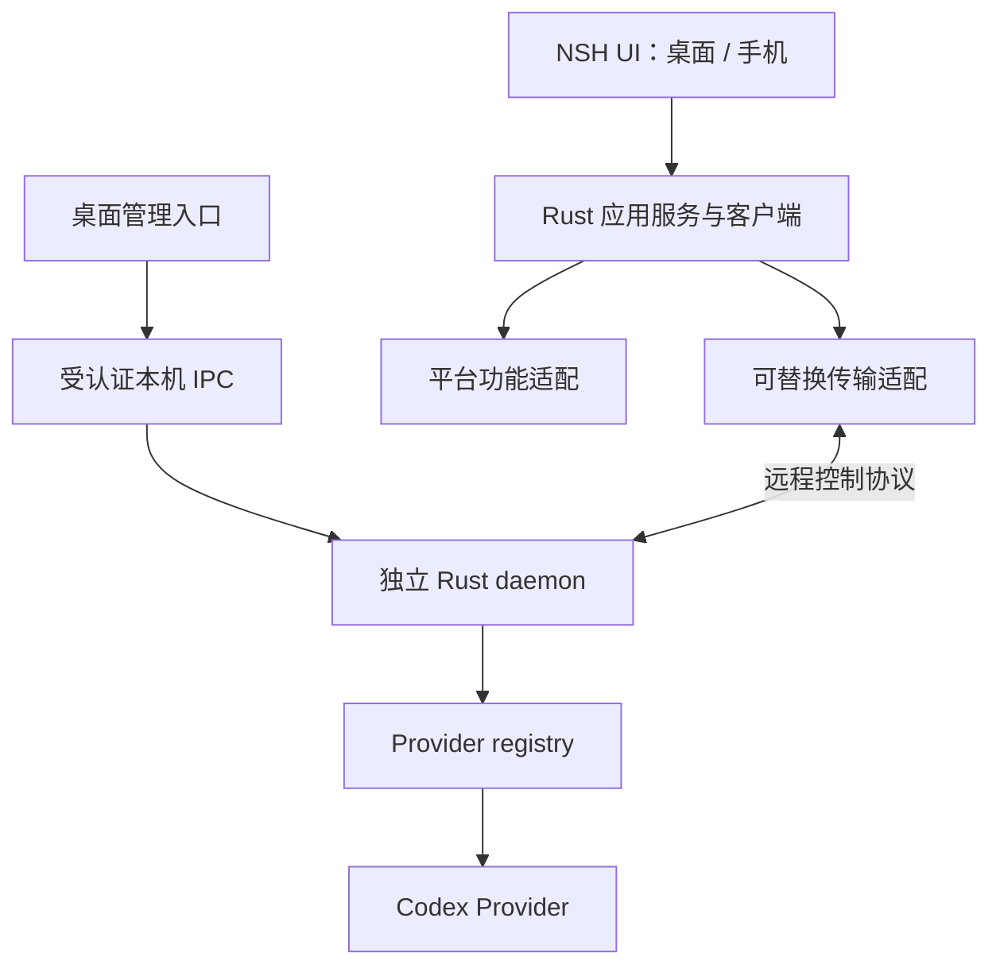

# NSH + Rust 技术栈调整（已归档）

状态：2026-11-11 历史调研，未实施。当前采用 [NSGo + Go 架构](engineering/architecture.md)。以下保留历史调研，不再作为实施要求；其中“桌面不支持会话管理”的职责限制也已取消。未安装 NSH 或迁移 Rust 代码。

## 决策与边界

目标 UI 统一为 [Native Shell（NSH）](https://nsh.dev/)，核心逻辑统一为 Rust。此处仅描述当时的候选方案，不是当前技术栈。NSH 调研基线为官网 v0.4.0；实施时固定 CLI 与 crate 的兼容版本，不直接跟踪 main。

推荐先采用 NSH mixed 模式：共享 TSX 页面和组件，Rust 导出类型明确的应用服务。原生 TSX 在 QuickJS 执行，界面由原生后端呈现，不是在 WebView 中运行网页；Web 采用浏览器 JavaScript、DOM 与 Wasm。NSH 也支持纯 Rust UI，因此业务核心不应依赖 TSX，后续页面可按需要使用 Rust 组件。采用 mixed 是实现建议，不代表用户已单独选择 TSX 而排除纯 Rust UI。

统一 UI 技术不等于统一产品职责：桌面仍是 Agent 状态、接入、配对和服务配置；手机/Web 仍是远程主机、会话和审批交互。共享设计系统与业务模型，按角色组合页面，不把桌面强行改成会话管理器。

## 目标模块

```text
apps/agenthub/               NSH 应用：共享 UI、桌面/手机/Web 入口
crates/agenthub-model/       协议 DTO、错误、状态与能力模型
crates/agenthub-client/      配对、连接、RPC、客户端状态机
crates/agenthub-provider/    Agent 集成接口；仅主机使用
crates/agenthub-codex/       Codex Provider；仅主机使用
crates/agenthub-host/        本机发现、生命周期、配置与控制分发
crates/agenthub-transport/   传输接口及分平台实现
crates/agenthub-platform/    安全存储、相机/扫码、剪贴板等平台适配
bins/agenthubd/             独立 Rust daemon；桌面关闭后继续工作
server/                     自部署入口；具体网络服务待选型
```

以上是目标目录，尚未创建。不要让 NSH 的 UI/runtime 类型进入 Provider、控制协议或 SaaS 业务模型。共享数据和状态机应尽量可独立 cargo test；NSH 只负责呈现和用户操作入口。

原生端结构：



独立 daemon 管理 Agent 与主机凭据，NSH 桌面 UI 作为本机客户端。移动端无需启动 daemon 或本机 Provider。Web 仅编译浏览器可用的 client/model/transport 子集，不编译进程发现、文件访问或本机 Agent 执行能力；Rust 代码编译到 Wasm 不会解除浏览器网络和权限限制。

## 网络选型重新评估

NSH 负责 UI，不提供把任意 Rust UDP/QUIC 代码直接运行在浏览器里的能力。原生网络与浏览器网络仍需分别验证。

| 候选                       | 与 Rust 核心的关系                                                  | 浏览器与自部署关注点                                                      |
| -------------------------- | ------------------------------------------------------------------- | ------------------------------------------------------------------------- |
| Tailcat + derper           | Tailcat 是 Go；须保留 Go sidecar 或封装跨语言桥，不能称为纯 Rust 栈 | 官方 Web 路径以 DERP 中继为主；derper 提供 STUN 和 DERP                   |
| Iroh + 自建 relay          | Rust 候选；此前 Go/FFI 的主要顾虑随本次调整而变化                   | 必须核实所选版本的 Wasm、目标浏览器、relay 与直连支持，不直接承诺跨端 P2P |
| WebRTC + coturn + 信令服务 | 原生端选 Rust WebRTC 实现；Web 使用浏览器 WebRTC 适配               | 一台公网服务器可承载信令、STUN/TURN；原生 Rust 库与浏览器互通需验证       |

暂不锁定网络库，不因为已经迁移 UI 就隐式选择 Tailcat 或 Iroh。当时的 Pion/WebRTC 测试证明的是旧实现互通，不能当作新 Rust 实现已通过验证。既有加密协议也不能在改语言时直接替换密钥派生/nonce 而继续使用同一协议版本。

公网服务器自部署是当前重点候选部署方式；不再以“所有网络能力必须放进 CF Worker”为架构前提。CF 仍可作为可选静态资源/API 平台。没有购买、创建或部署任何公网资源。

## 开源与闭源 SaaS

延续 [开源核心与闭源 SaaS 边界](open-source-boundary.md)：UI、Rust 核心、设备配对/撤销、Provider、传输和完整无账号自部署方案开源；匿名租户、账号、套餐、支付与运营代码保留在独立私有仓库。

Rust 连接核心只接收经过验证的连接权限与隔离空间，不依赖 User/Subscription 数据模型。自部署入口由实例策略产生权限，SaaS 入口由匿名/账号身份与权益产生权限。TSX 和原生应用包不包含 OAuth client secret、服务端签名私钥或支付凭据。

旧分层文档中的 Go `internal/` 与 TypeScript relay 包是原实现下的提取建议；新实现应采用这里的 Rust 模块边界。闭源业务层可组合公开 Rust 服务或经认证的服务接口，不预先要求所有云端模块也必须重写成 Rust。

## 实施前需要验证的能力

1. 在 macOS、iOS、Android、Web 分别构建运行最小 NSH 应用；不是只在浏览器中预览手机布局。
2. 跨端长列表、中文输入法、多行输入、历史分页、代码块/Markdown 与审批弹窗。
3. 主机二维码生成、手机原生相机扫码，以及 Web 扫码/粘贴入口。相机权限和扫码插件须核实或实现原生适配，不能假设 NSH 自动具备其它框架插件的能力。
4. Keychain/Keystore 等安全存储。通用文件/Storage API 不能默认当成安全密钥存储；Web 的配对凭据默认仅在内存。
5. daemon 与 UI 独立生命周期、本机 IPC 认证、关闭窗口后仍可连接；不自动重启官方 Codex App。
6. 固定网络库版本后验证真实双端连接、强制中继、跨 NAT、切网、前后台恢复及目标浏览器矩阵。

官方当前列出的原生最低系统包括 macOS 14+、iOS 15+、Android API 26+、Windows 10 1809+；Linux 后端需要 GTK 4.14+。Android 最低版本相比当时原型的 API 23 会提高，属于兼容范围变化。首次移植以 macOS 为主机端，移动端覆盖 iOS/Android，Web 为远程客户端，不把 UI 框架平台列表等同 Codex Provider 全平台已支持。

迁移按可运行功能进行：先验证 NSH 构建和平台桥接，再迁移 Rust 控制模型与 Codex 主机核心，最后以选定网络栈连通 NSH 远程客户端。确认功能与测试达到原 MVP 后再删除旧实现，避免只剩一个新 UI 空壳。

## 官方依据

- [NSH Rust、TSX 与 mixed 模式](https://nsh.dev/docs/rust/)
- [NSH 平台后端与最低系统](https://nsh.dev/docs/platforms/)
- [Web 的 DOM 与 Wasm 架构](https://nsh.dev/docs/web/)
- [NSH 安装、构建与目标工具链](https://nsh.dev/docs/installation/)
- [Tailcat Go 库与自建 DERP](https://github.com/tailscale/tailcat)
- [Iroh Rust 与跨端能力入口](https://www.iroh.computer/)
