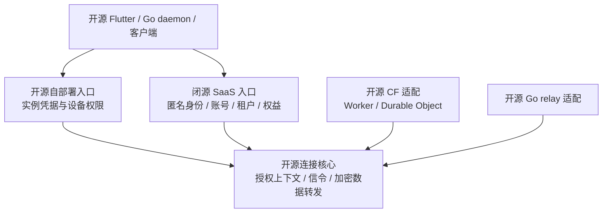

# 开源核心与闭源 SaaS 边界

状态：目标分层，2026-11-11。当前可运行的是开源私有部署 MVP；本文描述后续提取复用边界的方法，不代表已完成代码拆包、SaaS 实现或仓库许可证选择。

技术栈更新：目标统一为 [Flutter + shadcn_flutter / Go 产品 v2](product-v2.md)。桌面同时被控与远控，Web 直接使用浏览器适配，不要求 Wasm。Go 服务提供设备 ID 与连接核心；CF 仅保留为原型适配，本文涉及 Worker/DO 的部署细节不是新架构的强制要求。

## 原则

开源版是一套完整、可独立部署的产品。闭源 SaaS 基于开源连接核心组合业务模块，不维护一份修改过的 relay，也不要求开源版联系官方平台。

账号、匿名租户、组织、套餐、订单、支付、运营风控属于闭源业务层。设备密钥、扫码配对、设备授权与撤销、信令、P2P、加密中继、Agent Provider 属于开源基础能力。无账号不等于无连接认证。

## 分层与依赖方向



箭头表示调用/依赖方向。SaaS 的身份和权益模块依赖公开连接协议；连接核心不导入 SaaS 代码，不查询订阅表，不出现 GitHub、Google、Stripe 或具体套餐名称。CF 和 Go 复用协议与契约，分别采用 TypeScript 与 Go 实现，不假设跨语言共享同一个运行时库。

| 层 | 开源与否 | 职责 |
|---|---|---|
| 桌面、daemon、Flutter 客户端 | 开源 | 双角色桌面、Agent 状态、设备 ID/扫码、会话缓存与同步、通用登录/升级引导 |
| Provider 与本机控制协议 | 开源 | Agent 接入、会话与审批，本机执行 |
| 连接协议与核心 | 开源 | 设备信任、信令、P2P、加密中继、权限到期 |
| Go 自部署服务入口 | 开源 | 无账号设备登记/ID 分配解析、主机确认/密码授权、独立部署 |
| CF Worker / DO 与 Go relay 适配 | 开源 | 房间路由、连接生命周期、转发与计量机制 |
| SaaS 控制层 | 闭源 | 匿名租户、GitHub/Google、归属、组织、订阅、风控、运营 |

客户端可支持通用 `ACCOUNT_REQUIRED` / `SUBSCRIPTION_REQUIRED` 响应以及服务端声明的入口；这不会把 SaaS 的账号库、策略或支付实现带进开源仓库。客户端不携带 OAuth client secret 或支付密钥。

## 开源核心的授权边界

核心接收经过验证的最小连接上下文，而不是完整 User、Tenant 或 Subscription：

```typescript
type ConnectionGrant = {
  namespace: string;
  hostId: string;
  deviceId: string;
  role: 'host' | 'client';
  scopes: string[];
  expiresAt: number;
  grantId: string;
  limits: {
    maxConcurrentClients: number;
    maxFrameBytes: number;
    maxConnectionRelayBytes?: number;
  };
};

interface ConnectionAuthorizer {
  authorize(request: Request): Promise<ConnectionGrant>;
}
```

以上为目标契约草案。自部署适配器将实例配置和已配对设备权限转换成 grant；SaaS 适配器将匿名/账号身份、主机归属和套餐转换成相同 grant。自部署无需创建模拟用户、匿名租户或计费账户。

`namespace` 是连接资源隔离标识：自部署由服务端固定为实例空间；SaaS 由服务端映射为租户空间。核心只将 `(namespace, hostId)` 作为房间键，不需要了解它来自哪种业务身份。键应采用规范序列化或带长度编码，避免字符串拼接碰撞。客户端提交的 namespace、role、额度均不作为授权依据。

授权入口先验证凭据，再创建 DO；只能由受信入口向房间传递 grant，必须清除客户端伪造的内部元数据。DO 在 attachment 中保存通过校验的上下文，并在休眠唤醒后继续检查期限和权限。不能因核心“不懂租户”就放松跨空间隔离。

签名票据验证、短期租约、授权续期/撤销、通用连接额度执行可以开源；谁能拿到票据、绑定哪个 namespace、免费额度多少、什么情况下要求付费属于闭源策略。信任的签名公钥/issuer 由所连接实例配置，不能在核心中写死官方平台。

每条连接/房间的技术限制由核心执行。跨房间、跨主机、按租户/计费账户汇总的配额，由 SaaS 的原子配额协调与预留机制负责；不能给每条连接重复分配一份完整套餐额度。核心暴露明确的计量事件与拒绝/撤销接口。若只做异步汇总，应明确存在超用窗口，不能声称实现严格总量限制。

设备端到端信任与服务接入授权分别验证：获得中继接入票据本身不能控制主机，也不能替代主机对客户端设备密钥/授权范围的核验。配对秘密与会话明文不进入 SaaS 业务层。

## 两种服务入口

### 自部署

```text
客户端 -> 自部署入口（实例接入 + 设备授权）
       -> 开源连接核心 -> CF DO 或 Go relay
```

开箱无需账号、OAuth 或支付配置，不访问官方授权服务器。保留扫码、设备撤销、直连与中继等完整基础能力。固定实例 namespace 是服务内部配置，无需给用户暴露“租户管理”。

当前 v1 共享 token / 长期 PSK 可继续作为私有 MVP；它尚不具备独立设备授权/撤销。后续 v2 配对与短期 grant 应进入开源基础能力，不能把安全配对只留给付费版。

### 托管 SaaS

```text
客户端 -> SaaS API（匿名注册 / 可选账号 / 设备归属 / 权益）
       -> 受信连接 grant -> 同一开源连接核心 -> CF DO
```

逻辑上分层，不要求每次连接经过两台服务器。第一版可在闭源 Worker 入口导入开源 CF relay 模块，和 DO 部署在同一 CF 项目；D1 保存闭源业务元数据。后续需要时再分离控制服务与中继节点。客户端到主机的加密数据不经账号/支付服务逐帧处理。

客户端使用服务声明的 capabilities、认证入口和标准错误码；切换自部署服务只需服务地址与重新授权，不为不同部署维护两份客户端。

## 免费免注册到收费

免注册是 SaaS 的一种接入策略；开源自部署无需 SaaS 匿名租户模型。公共服务从首次连接起就自动生成匿名归属和设备凭据；用户不填写账号，但服务器不能把所有人放在一个共用权限空间。输入 ID/扫码后可通过主机确认或密码建立跨匿名空间的特定设备授权，核心按目标主机的 namespace 验证，不能要求双方最初就有同一个匿名归属。

```text
首次使用 -> SaaS 自动建立匿名归属 -> 签发连接权限 -> 开源核心转发
后续绑定 -> 验证原设备 + GitHub/Google -> 保留设备与配对关系
启用收费 -> SaaS 根据套餐签发/续期连接权限 -> 核心按权限执行
```

不改 Agent Provider，不搬迁电脑上的会话，不重新给每台设备配对。账号认领、多个匿名空间统一计费、过渡期、支付 webhook 等细节见 [产品与租户设计](product-and-tenancy.md)。

公有服务可拒绝未满足权益的连接/续期。自部署始终独立运行；第三方可修改开源客户端或自建服务，因此商业边界是托管服务与其增值能力。P2P 已建立时无法靠中继立即切断全部业务数据；标准主机按通用短期授权租约执行到期策略，不终止官方 Agent 的本地任务。

## 仓库与发布建议

```text
agenthub/                         公开仓库，当前工作区
  cmd/ internal/                 桌面、daemon、Provider、Go 网络实现
  clients/flutter/               目标：桌面、手机和 Web UI / 必要浏览器适配
  packages/relay-core/           目标：公开 TypeScript 连接核心
  deploy/cloudflare/             自部署 CF 入口与配置
  docs/                         公开协议、扩展契约、自部署说明

agenthub-cloud/                  目标：独立私有仓库
  worker/                       SaaS 组合入口，依赖 relay-core 的固定版本
  identity/ tenancy/            匿名归属、OAuth、租户与账号设备归属
  entitlements/ billing/        权益、配额协调、支付
  migrations/                   SaaS D1 schema
  operations/                   运营、审计与风控
```

以上为目录建议，尚未创建这些新包或私有仓库。闭源代码不先写进公开仓库再删除。开源 CF 包导出 handler/room 的可组合接口，私有 Worker 自己导出组合后的 DO 类并维护其绑定与迁移；从当前 Worker 提取时保留已有 DO 类名/namespace 或提供显式迁移方案，避免丢失在线连接与状态。

当前 Go 代码在 `internal/`，外部 Go module 不能直接导入。私有 Go 服务组合开源核心时，应将稳定设备服务/授权/连接接口提取成独立公开模块或通过经认证的服务 API 调用；不把闭源业务放进公开 internal 包再以构建参数隐藏。上面的 relay-core/Worker 目录是原 CF 原型拆包示例，目标以 Go 公开模块和独立私有 Go 服务为准。

开源许可证必须允许预期的闭源商业组合，并核对依赖与分发义务；如希望许可边界简单，可优先评估 Apache-2.0 或 MIT。不能默认任何开源许可证都允许以同样方式闭源组合；正式开源前再确定具体许可证。

## 实施顺序

1. 实现开源 Go 设备服务与 ID 分配解析，提供无账号自部署；Flutter + Go 使用统一协议。
2. 实现 v2 主机确认/密码授权、独立设备 grant/撤销、同步缓存与授权续期；按产品基准验收多设备连接。
3. 官方服务组合相同核心，闭源部分仅负责匿名归属、隔离、权益与运营；通过跨 namespace、角色、伪造 grant、过期与重放测试后再公测。
4. 按需加 GitHub/Google 绑定与同账号自动配对，最后接支付。

设备 ID 服务、新授权与 Go bridge 已在 MVP 中实现；SaaS 商业业务层尚未实现，详见 [MVP 实现](mvp.md)。
