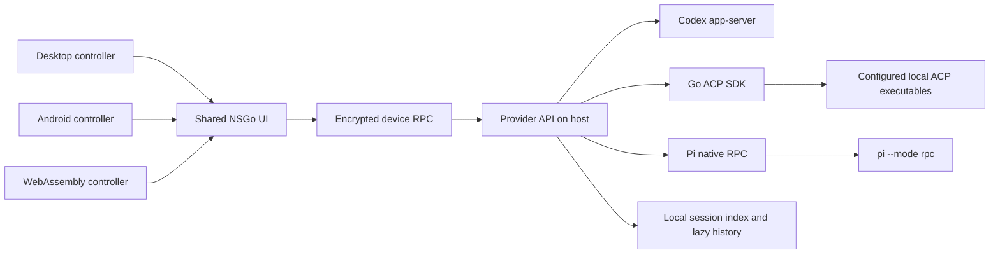

# Agent provider design

Reference reviewed: [T3 Code](https://github.com/pingdotgg/t3code/tree/295a0a7332aa1b0cc2f737dae71bd5e607a6ebb9), 2026-11-16. Launch entries for Cursor, Muse, Gemini and Claude were also checked against the [official ACP Registry](https://cdn.agentclientprotocol.com/registry/v1/latest/registry.json).

## What we adopt

| T3 Code design                                     | ReignHub application                                                                                                                                  |
| -------------------------------------------------- | ----------------------------------------------------------------------------------------------------------------------------------------------------- |
| Driver metadata separate from provider instances   | Agent presets plus stable, configurable instance IDs. Each instance has an independent runtime map and event log.                                     |
| Native adapters emit shared domain events          | Codex, ACP and Pi emit the existing Provider sessions, turns, items, approvals and streaming events. Native and Web controllers keep one NSGo UI.     |
| ACP protocol layer shared across compatible agents | Use `coder/acp-go-sdk`, not separate JSON-RPC implementations per brand. Negotiate ACP v1; do not advertise v2 preview support.                       |
| Models and capabilities belong to the live runtime | Read ACP prompt capabilities and per-session config; preserve Pi provider/model identity as a JSON pair. Unsupported steering is disabled.            |
| Native session identity separate from app identity | Random ReignHub IDs for owned conversations; deterministic provider/native ID hashes for imported ACP sessions. Persist the native reference locally. |
| Native discovery is distinct from message loading  | Discover ACP session metadata at most once a minute; only restore history when opened. Existing controller caches remain local-first.                 |
| Long-running work belongs to the host              | Prompt goroutines use host lifetime, not the controller RPC context. A remote disconnect does not cancel the task.                                    |
| Agent-owned permissions are surfaced explicitly    | Exact ACP option IDs; never reinterpret “always” as a one-time grant. Pi non-read-only tool hook uses its extension confirmation API.                 |

Sources: [driver and instances](https://github.com/pingdotgg/t3code/blob/295a0a7332aa1b0cc2f737dae71bd5e607a6ebb9/packages/provider-core/src/server/driver.ts), [provider boundary](https://github.com/pingdotgg/t3code/blob/295a0a7332aa1b0cc2f737dae71bd5e607a6ebb9/packages/provider-core/src/server/ProviderAdapter.ts), [built-in drivers](https://github.com/pingdotgg/t3code/blob/295a0a7332aa1b0cc2f737dae71bd5e607a6ebb9/apps/server/src/provider/builtInDrivers.ts), [ACP behavior](https://github.com/pingdotgg/t3code/blob/295a0a7332aa1b0cc2f737dae71bd5e607a6ebb9/docs/user/providers-acp.md), [Pi RPC framing](https://github.com/pingdotgg/t3code/blob/295a0a7332aa1b0cc2f737dae71bd5e607a6ebb9/packages/provider-pi/src/server/rpc.ts).

## Runtime boundary

No change to Worker signaling, pairing, relay or policy interfaces is needed. The private service consumes the same provider metadata through the public transport boundary. Executables, arguments and environment values are local host configuration, never remote session parameters. `host.*` remains blocked by `HandleRemote`.

## Transport coverage

Codex App and CLI retain their dedicated app-server providers. Claude Code, Cursor, OpenCode, Grok Build, Antigravity, Kiro, Muse Code, fx, DeepSeek Harness and Gemini CLI use ACP launch presets. Pi uses native RPC and an injected local approval extension.

T3 Code uses dedicated SDKs for Cursor and Muse. We use their currently published official ACP entry points (`cursor-agent acp`, `muse acp` with `MUSE_EXPERIMENTAL_ACP=on`) to keep the host free of an additional JavaScript SDK runtime and reuse the same protocol and UI. This covers portable ACP features, not every SDK-specific T3 feature.

Local command configuration takes effect after restarting ReignHub. The dispatcher provider map stays immutable after startup, avoiding concurrent map mutation while paired clients issue requests. Multiple instance IDs do not imply isolated Agent credentials; use the Agent's own home/environment settings for that.

## Persistence and recovery

The new `agents.db` uses the existing private-permission SQLite settings store. It stores per-instance metadata indexes and separate per-session history records; no cloud schema is required. Persist history before including a new ID in the index. Serialize snapshot writes so an older completion cannot overwrite a newer transcript.

ReignHub-owned sessions resume with the stored native session ID or Pi session file. ACP `session/load` replay becomes canonical history. Native sessions are listed only when both listing and loading are advertised. SDK/tool reasoning and raw tool output are not exposed as user-facing messages.

## Validation and scope

Subprocess fixtures exercise actual ACP JSON-RPC and Pi JSONL framing, fragmented writes, Unicode text offsets, per-session model options, exact permission choices, cancellation, native history replay, process exit, lazy discovery and persistence. Tests also verify that ending a controller request does not end an Agent prompt.

Agent packages and authenticated model accounts are not installed by these tests. Each vendor's current authenticated executable still requires live integration testing in its target environment. Client-side ACP filesystem/terminal APIs, ACP v2 preview features, T3-specific checkpoints/worktrees/MCP delegation and vendor-specific SDK features are outside this implementation's advertised capabilities.
