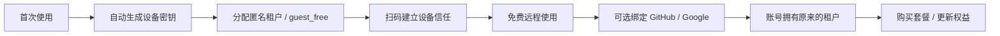

# 产品与租户设计

状态：2026-11-11 的 SaaS 身份与收费规划，保留作业务设计参考，不代表已实现能力。当前客户端采用 NSGo + Go，部署与授权协议以 [后端架构](engineering/architecture.md)、[自部署说明](platform/self-hosting.md) 和 [协议](platform/protocol.md) 为准。

边界：开源版提供完整无账号自部署能力；匿名租户、账号与计费由独立闭源 SaaS 业务层实现。本文件描述业务目标，不要求将以下租户/用户模型放进开源核心。具体代码与部署边界以 [开源核心与闭源 SaaS 边界](open-source-boundary.md) 为准。

## 产品职责

- NSGo 桌面：设备导航与远程会话界面，本机 Agent 放在设置页；Go 核心在同一进程承担被控和控制职责。
- NSGo iOS / Android / Web：设备配对、多设备、会话与审批；原生端使用 Go 核心，Web 使用 Go WASM + DOM 和浏览器网络/存储适配。
- Provider：封装 Agent 本地接入；Codex App / CLI 为独立接入项，可复用协议适配。网络、租户和套餐不进入 Provider。
- Go 服务：开源无账号自部署与官方服务共用的设备登记、ID 解析、信令与加密 relay；SaaS 在外层组合身份/权益，不要求 CF。
- SaaS 数据库：身份映射、租户、主机/设备归属、授权引用、套餐和汇总用量；不保存聊天正文、Agent 登录凭据或主机端到端私钥。D1 是旧 CF 方案的选项，不是必需依赖。

开源/闭源通过模块与仓库边界分离。SaaS 内部再区分匿名免费、账号免费和订阅要求，不用一个全局“是否登录”开关把业务耦合进连接核心。

## 两种部署形态

| 属性     | 私有实例                                    | 公有 SaaS                                              |
| -------- | ------------------------------------------- | ------------------------------------------------------ |
| 身份入口 | 实例凭据 + 设备身份                         | 先匿名设备身份，后可绑定 GitHub / Google               |
| 用户体验 | 填私有地址，输入该实例的设备 ID 或扫码      | 使用内置公有服务，输入设备 ID 或扫码                   |
| 隔离空间 | 固定实例 namespace，无需租户模型            | 自动分配匿名租户，映射为 namespace                     |
| 数据库   | 可不启用账号 D1                             | 需要租户/设备/策略持久化                               |
| 连接授权 | 主机确认或主机密码认证，记住设备/单设备撤销 | 相同主机授权；后续支持同账号自动配对，加服务端短期票据 |
| 限制     | 本地技术限制，无 SaaS 套餐概念              | 闭源 EntitlementResolver 输出连接权限与额度            |
| 收费关系 | 不依赖我们的公有平台                        | 购买托管服务套餐                                       |

私有实例无账号不代表允许任何人控制 Agent。仍必须验证实例接入凭据、设备配对和端到端身份。私有实例独立运行，不强制联系 SaaS 校验订阅。

## 先匿名免费，后绑定账号



无账号只是没有注册流程，服务端仍有可验证的身份和归属。匿名租户 ID 必须由服务端生成；不能接受调用者自行指定租户，也不能把随机 hostId 当成租户认证。

首次桌面启动：生成安装设备密钥，提交公钥，响应服务端短时一次性 challenge，验证持有私钥后创建匿名租户与主机。服务端返回与设备绑定的凭据，客户端安全保存。匿名注册必须有限速和平台总量上限；清空客户端或换 IP 可以绕过单设备免费配额，不能把匿名设备当成一个已验证的人。

账号绑定必须同时验证已登录账号和匿名租户的 owner 设备私钥，并要求服务端 challenge 一次性使用。拥有一段旧二维码、知道 tenantId、登录了任意账号，都不足以认领匿名租户。

绑定时原地增加租户所有权和 membership，保留 tenantId、hostId、deviceId、设备密钥与配对授权。Agent 会话一直在电脑上，不需要迁移。一个账号可认领多个原有匿名租户；第一版在 UI 聚合展示即可，不必强制合并 tenantId。租户隔离与计费归属分开：认领后可把个人名下的租户关联到同一 billingAccount，由该账户的套餐统一计算主机数/并发和用量，避免用户拥有两台旧电脑就被迫购买两份个人套餐。团队以后可有独立 billingAccount。

未绑定账号时，如果所有 owner 设备私钥和恢复材料均丢失，无法凭空找回匿名租户。可以在后续提供离线恢复码；不能用知道主机名称或邮箱作为恢复依据。

GitHub / Google 的不可变身份 `(provider, issuer, subject)` 映射到内部 userId。不得以邮箱相同自动合并账号；添加第二个登录方式应由已登录用户显式绑定。Google 可走 OIDC；GitHub 的 OAuth 身份适配器同样输出统一 Principal，无需强行让 GitHub 成为 OIDC 服务。

## 身份、设备与权限

概念模型：

```text
users                  内部用户；匿名阶段不存在对应账号
external_identities    provider / issuer / subject -> userId
tenants               id / kind(anonymous|personal|team) / ownerUserId(nullable)
memberships            userId / tenantId / role
hosts                  tenantId / hostId / ownerDeviceId / name / status
devices               tenantId / deviceId / connectionId / publicKey / capabilities / revokedAt
pairing_grants         tenantId / hostId / deviceId / scopes / revokedAt
billing_accounts       ownerUserId / providerCustomerId；匿名时可为空
subscriptions          billingAccountId / plan / status / currentPeriodEnd
usage_buckets          billingAccountId / tenantId / period / relayedBytes / relaySeconds
```

所有租户资源查询都带 tenantId 条件，并检查当前主体是否有权限。设备可以同时提供 host/client 能力，角色属于本次连接。免注册设备可以通过主机确认/密码建立跨匿名归属的设备授权：由授权解析目标主机空间，而不是要求双方预先属于同一租户；不能放宽成跨租户任意访问。即便个人版目前一个账号一个租户，也不能长期把 userId 与 tenantId 当作同一字段。

以下身份与权益接口位于闭源 SaaS 控制层：

```typescript
type Principal = {
  tenantId: string;
  deviceId: string;
  userId?: string;
  role: "owner" | "client";
  authKind: "private" | "anonymous" | "account";
};
interface Authenticator {
  authenticate(request: Request): Promise<Principal>;
}
interface EntitlementResolver {
  resolve(principal: Principal): Promise<Entitlements>;
}
interface RelayAuthorizer {
  authorize(
    principal: Principal,
    hostId: string,
    role: "host" | "client",
  ): Promise<ConnectionTicket>;
}
```

开源核心不接收上述含 tenantId/userId/套餐的业务模型。自部署入口和 SaaS 入口分别产生通用 ConnectionGrant（namespace、hostId、deviceId、role、scopes、有效期与技术额度），交给同一连接核心；详见分层文档。配对、设备密钥与权限校验仍是开源能力。

## 配对和连接

MVP 以 [当前配对协议](platform/protocol.md) 为准：输入设备 ID 或扫码寻址，首次连接由主机确认或密码验证，后续可记住设备；同账号自动配对后续加入。以下一次性邀请是可选配对形式，扫码本身不能绕过主机配置的授权策略。

目标二维码包含 serviceUrl、协议版本、设备连接 ID、公钥指纹；可附短时一次性 invitationId 和邀请秘密。不包含平台管理密钥、账号 access token、主机密码或长期主机私钥。

1. 主机创建配对邀请，指定本机、有效期和允许的权限。
2. 手机/Web 生成自己的设备密钥，扫码并证明持有邀请秘密。
3. 主机确认或验证由其主动生成的一次性邀请，建立独立 device grant；扫描端只能加入已有租户，不能修改 owner。
4. 通过已认证的密钥协商建立主机/客户端端到端信任。不要自行发明未经审查的签名/密钥交换协议；选择成熟实现并做互通测试。
5. 以后连接使用自己的设备凭据申请票据，不再重复使用邀请。
6. 撤销设备时移除 grant、使相关票据失效并通知在线主机关闭对应通道。轮换手机权限不需要把所有设备一起踢下线。

当前 `agenthub1:` 是长期共享 PSK 配对 MVP，暂不能等价于以上一次性设备授权。升级应使用新版本配对码，SaaS 拒绝旧版共享密钥接入；私有实例可显式允许旧版。

连接票据示例：

```json
{
  "iss": "agenthub-service",
  "aud": "agenthub-relay",
  "tenantId": "server-assigned-tenant",
  "hostId": "registered-host",
  "deviceId": "authorized-device",
  "role": "client",
  "scopes": ["agent:read", "agent:control"],
  "jti": "unique-ticket-id",
  "exp": 1800000600,
  "policyVersion": 3
}
```

票据须校验签名、issuer/audience、有效期、租户成员/设备状态、主机归属和 role。建议加一次性消费与设备密钥持有证明；不能把 bearer 票据安全性等同设备绑定。

SaaS 授权入口完成校验后将目标主机的 tenantId 映射为受信 namespace；核心使用规范编码的 `(namespace, hostId)` 生成房间键。浏览器不能靠传一个 tenantId 切房间；核心使用入口校验后传入的连接上下文并清除伪造元数据，角色与隔离空间进入授权范围。原 CF 适配中的 Worker/DO 也必须遵守此规则。

浏览器通过 HTTPS 领取极短期单次连接票据，用 WS subprotocol 或首帧提交，避免长期 token 出现在 URL/日志。校验精确 Origin；不使用 `*` 允许任意网站。Web 端不能把浏览器 cookie 自动携带等同主动设备授权。

## 服务发现与策略变化

客户端先访问 `GET /v1/capabilities`：

```json
{
  "protocolVersion": 2,
  "deployment": "saas",
  "anonymousAllowed": true,
  "loginProviders": [],
  "accountRequired": false,
  "billingEnabled": false
}
```

后续可以逐项启用 `github` / `google`、可选账号绑定、付费套餐与登录要求。`capabilities` 用于呈现 UI；所有限制仍由服务端执行。匿名设备认证、票据获取和策略错误码在免费首版就必须存在，不能依靠老客户端自愿显示付费页面。

权益模型示例（数量只是配置项，不硬编码进 Provider）：

```typescript
type Entitlements = {
  plan: "guest_free" | "free" | "pro";
  accountRequired: boolean;
  allowNewConnections: boolean;
  allowRelay: boolean;
  maxHosts: number;
  maxConcurrentClients: number;
  relayBytesLimit: number | null;
  leaseSeconds: number;
};
```

同一 SaaS 可以同时保留匿名免费、已绑定免费和付费用户，也可以在日后将公有远程服务调整为需要账号/付费。已有匿名租户可使用 grandfatherUntil / promotionExpiresAt 过渡，避免无预告立即断开。付费开通以服务端验证的支付 webhook 为准，并做事件去重；不是跳回成功页面就开权限。

错误码稳定为 `ACCOUNT_REQUIRED`、`SUBSCRIPTION_REQUIRED`、`QUOTA_EXCEEDED`、`DEVICE_REVOKED`、`PROTOCOL_UPGRADE_REQUIRED`，控制端根据响应呈现绑定、升级或重试入口。

## P2P 与收费边界

开连接、续租、使用中继都检查权益；已有 WebSocket 不能只在握手时检查一次就永远放行。连接核心对在线链接设置授权到期和限额，限额按 tenant 及所属 billingAccount 汇总，不能把每台主机的独立额度误当租户/套餐总额度。

成功 P2P 后，中继无法直接看见或立即阻断业务数据。标准桌面主机必须验证服务端签名的短期授权租约，例如 10 分钟有效，在信令通道仍在线时接收撤销通知，到期后续租；失联或到期按公有服务策略停止接受新的远程控制。订阅到期不强制终止官方 App 本地正在执行的任务。

离线宽限、即时撤销与长期离线可用无法同时无限保证，产品需给出明确上限。私有部署可使用其自身本地策略，不受公有 SaaS 订阅限制。

开源客户端可被修改、自建服务也可被使用，因此可以强制收费的边界是我们托管的协调、身份管理、中继与增值功能。不能声称后台收费开关可以封锁用户已建立的任意独立 P2P。中继字节数可在服务端计量；直连业务流量不能靠 relay 可靠计费。

## 部署与分阶段发布

目标采用 Go 服务，提供完整无账号自部署入口；官方服务在同一开源核心外组合 SaaS 业务。现有 Worker/DO/D1 是旧原型的可选部署组合，不能作为全部 UDP/P2P 基础设施。所有部署都需要整体登记、连接和消息上限，避免某个匿名设备耗光公共资源；本次未部署或购买服务。

以上匿名/账号/权益业务在独立私有仓库实现；开源核心与客户端仅增加通用授权、服务发现和错误处理能力。初期不开收费的推荐发布顺序：

1. 私有部署 MVP 和端到端客户端互通；当前代码属于此阶段。
2. 匿名身份、租户持久化、设备配对/撤销、租户隔离、短期连接票据与租约；通过跨租户/跨角色测试后才能作为公有免费服务上线。
3. 加 GitHub / Google 可选绑定与恢复，保持匿名入口可用。
4. 接支付与权益策略。根据经营策略保留免费档，或要求绑定并购买；协议和主机不重建。

公有首版不用先实现支付或所有社交登录，但不能省略第二步，否则后续无法安全地证明谁拥有已有匿名电脑。

参考：

- https://developers.cloudflare.com/durable-objects/platform/pricing/
- https://developers.cloudflare.com/d1/platform/pricing/
- https://docs.github.com/en/apps/oauth-apps/building-oauth-apps/authorizing-oauth-apps
