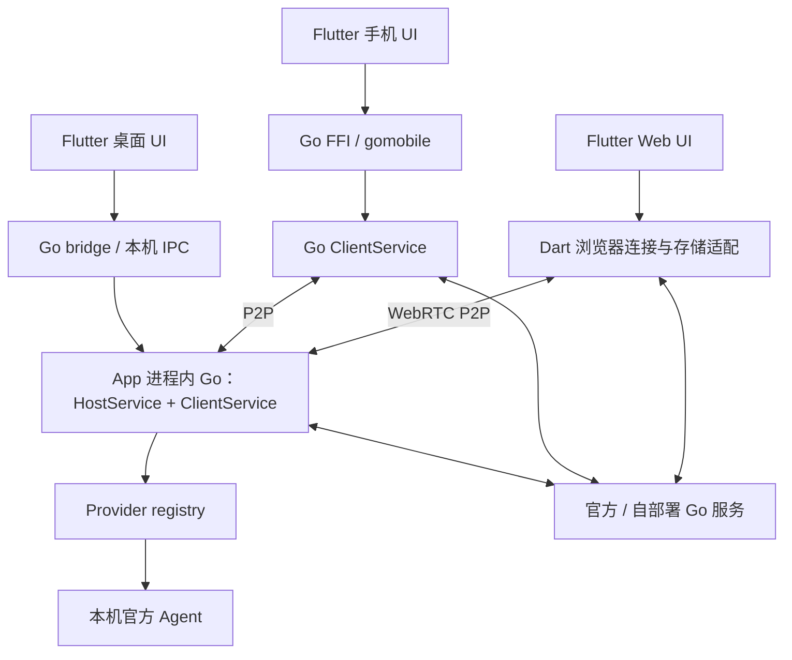

# Agent Hub：设备连接与 Agent 会话管理

状态：2026-11-11 产品与架构基准。Flutter + shadcn_flutter、Go bridge、设备 ID 服务、两种授权、多设备和目录同步已接入 MVP，具体运行范围与验证见 [MVP 实现](mvp.md)。本文件中系统密钥库、完整消息事件增量、SaaS 身份和跨平台 Provider 等仍是后续目标。旧 MyGo / 私有共享 token 原型保留供回归。

## 产品与平台

产品提供类似远程桌面的设备连接体验，连接后操作的是被控设备上的官方 Agent 及其真实会话。官方服务分配设备连接 ID，控制方通过输入 ID 或扫描二维码发起连接。安装、运行和允许被控制是三个不同状态。

| 平台 | 被控能力 | 控制能力 | UI 与核心 |
| --- | --- | --- | --- |
| macOS / Windows / Linux 桌面 | 本机 Provider 支持范围内可用 | 可同时连接多台电脑 | Flutter + 进程内 Go FFI |
| iOS / Android | MVP 不承载本机 Agent | 可同时保存、连接多台电脑 | Flutter + 嵌入式 Go 核心 |
| Web | 不发现或控制浏览器所在电脑的本机进程 | 可连接多台电脑 | Flutter Web + Dart 浏览器适配；业务服务在 Go |

平台支持目标不等于所有 Provider 已跨平台验收。Codex App 的私有启动入口、CLI 后台接入按具体平台和版本检测。

统一使用用户指定的 [shadcn_flutter](https://sunarya-thito.github.io/shadcn_flutter/)，不是 React shadcn/ui 或 WebView。MVP 锁定 0.0.53，兼容现有 Flutter 3.41.6 / Dart 3.11.4；没有升级用户的全局 SDK。

## 桌面布局

左侧固定设备导航：本机、添加设备、已保存的远端设备、设置。默认选择“本机”，右侧显示被控状态面板；选中远端设备后，右侧整体切换为该设备的 Agent 会话工作区，不继续占用空间显示本机面板。

```text
默认进入
┌─────────────────┬───────────────────────────────────────────┐
│ 本机（选中）    │ 本机设备名称 / 连接 ID / 二维码 / 在线状态 │
│ ＋ 连接设备     │ 授权方式 / 已授权设备 / 当前连接           │
│                 │                                           │
│ 我的工作电脑    │ Codex App  已安装 · 需重启接入   [接入]   │
│ 家里的电脑      │ Codex CLI  已安装 · 已就绪       [管理]   │
│                 │ 其它 Agent 未安装                         │
│ 设置            │                                           │
└─────────────────┴───────────────────────────────────────────┘

选择远端设备
┌─────────────────┬──────────────────┬────────────────────────┐
│ 本机            │ 我的工作电脑     │ 当前会话 / Agent / 状态 │
│ ＋ 连接设备     │ Agent 筛选       │                        │
│                 │ 新建会话         │ 消息、工具活动与审批   │
│ 我的工作电脑 ●  │ 会话 A           │                        │
│ 家里的电脑   ●  │ 会话 B           │                        │
│                 │ 会话 C           │ 指令输入 / 发送 / 中断 │
│ 设置            │                  │                        │
└─────────────────┴──────────────────┴────────────────────────┘
```

设备切换只改变视图，不关闭其它设备连接或正在执行的任务。每台设备分别保存选中的 Agent、会话、分页位置、草稿和同步游标。已保存、正在连接、在线、断线、授权失效分别展示；正在后台执行或等待审批的会话显示标记。

桌面/Web 宽屏使用可调整宽度的设备栏、会话栏、对话区。手机使用设备列表 → 会话列表 → 对话页，保留相同的数据与操作模型。MVP 聚合所选设备上的所有已启用 Agent，会话可按 Agent 筛选；跨设备统一收件箱不作为首版必要功能。

视觉基线采用 shadcn_flutter 的主题、排版、按钮、输入、卡片、徽标、弹窗、菜单、骨架屏和可调整分栏。使用统一浅色/深色 token、中性色背景、细边框和一致间距。聊天正文支持 Markdown、代码块、复制和长列表；具体渲染组件另行验证，不假设 UI 库自带完整聊天系统。

## Go 与 Flutter 的边界

Flutter 负责展示、交互、导航和平台 UI；原生端设备身份、配对状态机、授权校验、连接管理、同步、缓存仓储与 Agent 集成放在 Go。相机、系统通知、Keychain/Keystore 等通过薄平台适配调用，不能因业务在 Go 就绕过平台权限。



桌面 Flutter 通过 C FFI 直接调用同一 App 进程内的 Go HostService / ClientService，不启动独立 daemon。macOS 关闭窗口后隐藏到菜单栏并继续允许已配置的远程访问，菜单栏提供退出整个应用的入口。新授权请求通过本机事件唤起授权窗口/系统通知；无人处理的手动授权超时拒绝。移动端不承诺系统挂起后维持常驻 Go 服务。

原生 UI 以统一异步 request/result + event stream 调用 Go。桌面 bridge 直接调用内存中的 Go Dispatcher；手机在应用内运行同一 ClientService，可选 C ABI FFI 或 gomobile 绑定，避免同时维护两套业务实现。取消 UI 等待不等于取消主机端 Agent 操作。

Web 不使用 Go FFI，也不要求 Go Wasm。Dart 适配层负责浏览器 WebSocket、RTCPeerConnection、数据通道、IndexedDB、游标应用与 UI 事件；授权、Provider 和服务端同步规则由 Go 执行。协议 DTO 可生成，但不假装 Dart 与 Go 共享同一个运行时核心。浏览器必须有连接/缓存适配代码，“Flutter 只负责 UI”在 Web 上的含义是复杂业务放在 Go 服务，不能理解为零 Dart 非视觉代码。

UI 不需要先升级为 Wasm 才能使用 WebRTC。浏览器正常通过 HTTPS/WSS 找到主机、交换信令，然后与主机的 Go WebRTC 端直接交换加密业务数据。公网服务也可用 Go/Pion 实现 WebRTC 对端，但若浏览器连接的是服务器，数据仍经服务器转发，不称为浏览器与被控电脑直连。

## 服务、设备身份与寻址

官方公有服务和无账号自部署服务实现同一协议。Go 服务统一提供设备登记、ID 分配/解析、在线租约、配对、信令、加密 WSS 中继和 TCP / UDP STUN。默认 TCP 26331 承载可选 Web、API、WS/WSS，TCP / UDP 26330 提供 STUN；无需 UDP 中继端口范围。公共 STUN 与自建 STUN 共同辅助直连，候选通过 Trickle ICE 及时交换；原生端并发尝试 TCP 映射探测、端口复用与双方同时拨号。直连失败统一走自己的 WS/WSS 中继；HTTP 公网 IP 部署可用，TLS 可选。MVP 不配置 TURN/DERP，不引入 Tailcat。授权与选路独立。

普通 CF Worker 不能承载完整 Go daemon 或通用 UDP STUN/TURN；现有 CF relay 是旧原型的可选部署适配，不是新方案的唯一基础设施。公有服务不能依赖全局共享 relay token。

必须区分以下标识：

| 标识 | 用途 |
| --- | --- |
| serviceId | 服务实例身份；同一个设备连接 ID 在不同服务上可指向不同设备 |
| deviceKey / fingerprint | 安装实例本地生成的设备密钥身份，是配对与重连的信任依据 |
| deviceId | 服务登记后的内部设备 ID；由服务分配并与公钥绑定 |
| connectionId | 人可输入的连接 ID；服务分配、校验冲突并解析到被控设备 |
| backendId | 被控电脑上实际 Agent 后端实例的稳定作用域 |
| sessionId | Provider 原始会话 ID，在对应 backend 范围内解释 |

首次运行在本地生成密钥，向所选服务证明持有私钥后登记并领取 ID。无需注册用户账号。桌面可同时声明控制和被控能力，不再将设备身份建模成只能取 host/client 其一。角色属于某次连接：同一电脑可一边被手机控制，一边控制另一台电脑。

输入 ID 与扫码只解决寻址，不能直接授予控制权限。二维码包含协议版本、服务地址/实例标识、连接 ID、主机公钥指纹；可附短期邀请 nonce，不包含长期密码或私钥。新服务地址需展示给用户，网页导航来源与凭据存储保持隔离。

本地保存设备列表时用 (serviceId, deviceId, fingerprint) 定位设备，connectionId 只用于展示与查找。连接 ID 不应立即回收给其它密钥；即使将来回收或重装变更身份，也必须触发新的信任验证，不能沿用旧设备授权。

服务登记/在线记录与会话缓存分离：云端保存连接所需元数据，聊天正文留在主机及已授权控制端的本地缓存。

## 首次授权、记住设备与撤销

MVP 提供两种授权方式；SaaS 同账号自动配对保留统一入口。

| 方式 | 首次连接 | 后续连接 |
| --- | --- | --- |
| 被控方确认 | 被控方显示控制设备名称/指纹、来源、申请权限并允许或拒绝 | 用户选择“记住此设备”则签发持久设备授权；否则只允许本次连接 |
| 被控方自定义密码 | 控制方输入密码，主机验证成功自动授权，无须再弹确认 | 可记住本次授权的控制设备；关闭记住或设备密钥丢失后重新验证密码 |
| SaaS 同账号（后续） | 可信账号服务证明双方设备归属同一个账号，主机按启用的策略自动配对 | 登录和设备归属有效时自动连接；账号解绑/设备撤销会失效 |

主机可以开启确认、密码或两者；密码通过即可自动允许，未提供/验证失败不能绕过。首次授权默认记住控制设备，UI 明确提供“仅本次”选项；记住的是独立设备授权，不是保存明文密码。以后无需重复人工确认，但每次重新连接都验证设备身份、授权范围和撤销版本。

密码只在端到端认证协议中验证，不发给 ID 服务，不放入二维码。实现选用成熟 PAKE 或经审查的等价认证方案，避免自制可离线枚举的 password hash challenge。密码验证成功必须绑定双方设备公钥和当次握手；错误尝试由主机限速，服务端另做连接/请求限速。具体库和平台互通是实现前验证项。

授权状态：resolving → connecting → awaitingApproval / awaitingPassword → authorized → syncing → ready；另外有 denied、expired、revoked、offline。网络连通不等于已授权；在 authorized 前不泄露 Agent 列表或会话。

主机本地持有配对授权，控制端保存对端公钥、授权引用和显示信息。提供查看当前连接、断开连接、撤销单台设备、停用密码和关闭被控入口；撤销后同时关闭 P2P 与 relay 通道。修改密码使旧密码证明失效；独立持久设备授权是否同时撤销由明确选项控制。

MVP 权限分为读取 Agent/会话、创建/发送/引导/中断、处理审批。后续可限制到特定 Agent/backend，授权不能因为连接由 relay 切换为 P2P 而扩大。

同账号自动配对由 SaaS 扩展产生同一设备授权，不进入 Provider。需要验证设备私钥持有和服务端账号归属，不能只比较客户端传来的 userId 或邮箱。主机默认允许已启用的同账号策略；允许用户关闭并撤销个别设备。跨账号或无账号通过手动确认/密码建立的信任仍可保留。

## Agent 启用与 Provider

桌面本机面板分别显示已安装、是否运行、是否可远控、具体能力和下一步操作。服务在线不是 Agent 就绪，后台进程存在也不代表有活跃会话。

| Agent 卡片状态 | 说明与操作 |
| --- | --- |
| 未安装 | 提供安装说明 |
| 已安装 · 未运行 | 可按 Provider 的启动流程启动 |
| 已安装 · 需重启接入 | 运行实例没有可附加入口；说明影响，用户明确确认后正常重启接入 |
| 已安装 · 连接中 | 正在验证后端握手和能力 |
| 已安装 · 已就绪 | 通过真实连接验证，可以远控 |
| 接入失败 / 版本不兼容 | 展示原因与重试入口 |

只有 ready / connected 且设备授权覆盖的 Agent 才允许远程调用。不设置额外的 Agent 远控开关；未就绪时「启用」执行该 Provider 的接入流程。可附加的运行中后台自动接入。只有用户显式选择的生命周期动作才允许启动/正常重启 Agent；不自动结束用户手动打开的实例。

Codex App 与 Codex CLI 在 UI 上是独立接入项，使用不同 providerId（例如 codex-app、codex-cli），底层可复用 Codex 协议适配器：

- Codex CLI：检测实际运行的官方共享后台，完成协议握手后可附加；当前 macOS 已验证查询已有会话、原 ID 接入、发送和流式结果。普通 CLI 在支持的版本/配置下按需启动 daemon，CLI 退出后 daemon 可常驻。独立模式不声称可直接附加。Windows 本地传输仍需单独验证。
- Codex App：被动发现安装和运行状态；当前私有启动入口可能需要用户明确重启后接入共享后端。这个入口有版本风险，不按 CLI 的验证结果宣称 App 也已经可附加。
- 每个入口记录对应 backendId、实际 endpoint、版本、Codex Home 作用域和能力。只有确认连接同一真实 backend 后才能复用一条连接和合并会话；不能仅凭同一 sessionId 或磁盘路径合并。

协议中的会话主键为 (serviceId, hostDeviceId, backendId, sessionId)。providerId 表示接入适配与 UI 来源；同一 backend 可由多个接入卡片引用，会话只展示一份并标注来源。不同 backend 即使历史 ID 相同也不擅自认定为同一个活跃会话。

Provider 边界包括发现、状态、能力、启用/停用、接入计划与确认、backend 枚举、会话分页/历史、事件订阅、创建、发送、引导、中断、审批。列表读取不隐式启动 Agent 或恢复全部会话；需要订阅/控制时才按 Provider 规则接入原会话。

“所有会话”指这个已启用接入后端原生可访问、且设备权限允许的会话。Provider 必须报告历史覆盖范围/来源限制；不能用共享磁盘历史推导其它独立运行实例的实时控制能力。

## 本地数据库与全量、增量同步

Agent 是原始会话事实来源；主机 Go 核心生成标准化索引、持久事件日志和同步接口；控制端缓存是可重建副本。官方服务默认不做云端聊天备份。

原生端使用 Go 管理的本地 SQLite 仓储；Web 使用 IndexedDB 存储相同的逻辑记录和同步元数据，不引入 Wasm 仅为复用 SQL 驱动。密钥与密码不放入普通会话表；原生凭据使用系统安全存储，Web 的长期身份与缓存是明确的“记住此浏览器”选项，私密模式可只存内存。未选择持久凭据时仍可保存非敏感显示信息，重连需要重新授权。

逻辑表：service_profiles、local_identity、saved_devices、device_grants、agent_bindings、backends、sessions、turns、items、pending_approvals、sync_state、command_receipts。主机另有 change_log 与授权撤销记录。所有缓存查询都带主机/backend 作用域；换服务或退出账号不能把旧缓存显示到新身份下。

首次授权后：

1. 主机创建有界 snapshot，返回 snapshotId、epoch、watermark、授权/过滤作用域和分页游标，并保留 watermark 之后的变更。
2. 控制端分页同步完整会话目录，优先加载最近/当前会话正文，旧正文按需分页；提供后台补齐历史选项。“全量”表示目录的完整基线，不要求先下载所有 token 才能使用。
3. 每个同步页事务写入缓存。未完成快照不能被当作完整目录，也不能误删尚未分页返回的记录。
4. 完成基线后订阅 watermark 之后的增量；传输可切换，但应用同一有序逻辑变更流。事件携带 epoch、seq、entityVersion、scope 和标准化实体键。
5. 控制端在同一事务中应用变更并提交 checkpoint；重复事件幂等处理，缺口从 checkpoint 补拉。删除/归档/撤销用明确事件或 tombstone，不靠列表消失猜测。
6. 重连携带 checkpoint。epoch 改变、保留期超出或权限范围变化时返回 RESET_REQUIRED 并重建相应作用域快照，不静默丢事件。

快照必须对应稳定 watermark：可以由主机物化目录或提供版本化读视图实现。不能分页读取持续变化的实时列表，再随意附一个当前序号就宣称不会漏数据。增量日志具有保留期；超期客户端依靠重新同步恢复。

运行中的 token delta 仅用于即时渲染，可合并写入数据库；最终 item/turn 事件校正为完整状态。pending approval 由主机重新确认是否仍有效。Provider 没有可靠历史事件时，使用周期性目录/历史校验与版本差异生成同步事件；本地事件日志不能凭空补出 daemon 未运行期间的外部变更。

新建/发送/审批等写操作包含由控制端持久保存的 commandId，主机持久记录接收/结果。断线后先查询执行状态，不能盲目重复发给 Agent；若后端没有幂等能力，进程在调用后、记录前崩溃仍存在不确定窗口，应返回 outcomeUnknown 并刷新原生会话，不承诺恰好一次。

多控制端可以同时订阅。对同一会话的写操作在主机端排序；执行中的任务按 Provider 能力选择追加引导、排队或拒绝，不无意启动第二个 writer。审批通过主机原子决议，首个有效答复生效，其它客户端收到 resolved / alreadyResolved。

离线可以查看已有缓存和编辑草稿；离线状态不可假装已经发送、审批或创建会话。删除本地连接与清除聊天缓存分别提供，清缓存不删除 Agent 的原始会话。

## 服务协议与开源边界

服务协议草案：service.info、device.register、device.resolve、presence.renew、connection.request、connection.respond、connection.ticket、signal.exchange、relay.connect。未配对请求只能获得允许公开的寻址信息与请求投递权限，不能取得读/控制 scope。

主机业务协议草案：host.status、pairing.pending/decide、grants.list/revoke、agents.list/enable/disable、agents.activationPlan/activate、sync.snapshot/changes/subscribe、sessions.create/send/steer/interrupt、approvals.decide、commands.status。复杂平台接入计划由主机返回，远控端不能提交任意进程启动参数执行。

开源版包括完整无账号服务、Flutter UI、进程内 Go 客户端 / 主机核心、设备 ID 注册解析、手动/密码配对、撤销、同步缓存、Provider、P2P 与加密 relay。官方服务使用相同开源核心。账号、租户、账号设备归属、自动配对策略、权益计费与运营放在独立闭源 SaaS 业务层；核心只接收已验证的通用连接权限。

SaaS 的匿名设备分别有服务端归属，但配对可跨原有匿名空间：服务先解析目标主机，再验证主机签发/确认的 device grant。不能要求两个免注册设备最初就在同一个匿名租户，也不能因为一个账号有访问权就允许访问另一租户的任意主机。

## 实施顺序与验收

1. Flutter + shadcn_flutter 双角色布局与统一 Go bridge 契约；清楚区分当前实现和目标，完成原生 SDK/依赖兼容验证。
2. Go 设备服务与本地身份/连接记录；支持 ID 查找、扫码、主机确认、密码授权、重连和单设备撤销。自部署不需要账号。
3. Codex CLI 共享 daemon Provider；复用已有 App 适配但保持独立状态与能力，验证同/不同 backend 会话归属。
4. 多主机连接、原生 SQLite/Web IndexedDB、目录快照、事件日志、增量恢复和聊天工作区；客户端逻辑逐步从现有 Dart 业务迁入 Go，保留必要浏览器适配。
5. P2P 与强制 relay、跨公网、移动端切网/前后台、撤销/审批竞争/断线未知结果验收，再开放官方免注册公测。
6. SaaS 后续增加 GitHub/Google 绑定、同账号自动配对、套餐；保留原设备身份和本地会话缓存，无需迁移 Agent 会话。

首版验收至少覆盖：一台电脑同时被控与远控；一个控制端连接两台主机且切换视图不掉线；拒绝授权无法读会话；密码错误限速；记住设备后重连与撤销；原 CLI 会话双端可见并发送；历史分页期间有新消息不漏数据；重连补齐与游标过期重建；原生/Web 冷启动读缓存；重复命令/审批不重复执行；关闭桌面窗口仍能收到需确认连接；独立 Agent 实例显示需接入且不被自动重启。

UI 依据：[组件文档](https://sunarya-thito.github.io/shadcn_flutter/)、[发布包与 SDK 要求](https://pub.dev/packages/shadcn_flutter)、[库 README](https://github.com/sunarya-thito/shadcn_flutter/tree/master/packages/shadcn_flutter)。Codex 依据：[App Server](https://learn.chatgpt.com/docs/app-server)、[CLI 命令](https://learn.chatgpt.com/docs/developer-commands?surface=cli)、[后台常驻与自动启动](https://learn.chatgpt.com/docs/environments/network-file-systems)。
